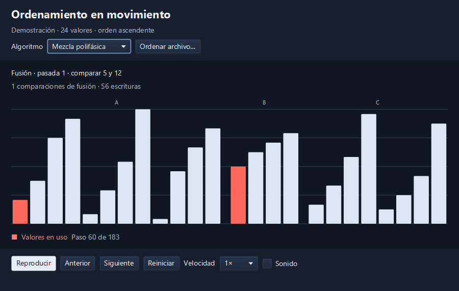

# External Sorting Algorithms

This JavaFX application sorts text files and animates the operations performed by three external sorting algorithms.

- **Polyphase Merge Sort**
- **Balanced Merge Sort**
- **External Radix Sort**

## Table of Contents
- [Overview](#overview)
- [Graphical Interface](#graphical-interface)
- [Installation](#installation)
- [Usage](#usage)
- [Sorting Algorithms](#sorting-algorithms)
- [File Input/Output](#file-inputoutput)
- [Tests](#tests)
- [Contributing](#contributing)
- [License](#license)

## Overview

The algorithms use temporary files to sort inputs larger than available memory. The visual demonstration records events from those same implementations for a fixed set of 24 integers.

## Graphical Interface



*Polyphase Merge Sort paused during a merge. The line above the chart names the two values being compared.*

1. **Algorithm and file selection.** Use **Algoritmo** to choose which algorithm to visualize. **Ordenar archivo…** runs the selected algorithm on a text file and displays the path to its result.
2. **Operation and counters.** The text above the chart shows the current phase and the values involved. The counters report merge comparisons and writes. Radix reports writes because it distributes values by digit.
3. **Bar chart.** Each bar keeps its height as its value moves. During merges, the labels **A**, **B**, **C**, and **D** identify temporary files. In Radix, a label such as **D2** identifies the bucket for digit 2. Red highlights the active values and green marks the completed output.
4. **Timeline and playback.** The progress bar and **Paso** counter show where you are in the recording. The controls below them let you play, pause, step in either direction, or restart.

## Installation

Use JDK 22 and Maven.

1. Clone the repository to your local machine.
   ```bash
   git clone https://github.com/MauricioART/External-Sorting-Algorithms.git
   cd External-Sorting-Algorithms
   ```

2. **Run the application**
   ```bash
   mvn javafx:run
   ```

On Windows, you can also use `.\mvnw.cmd javafx:run` from PowerShell.

## Usage

### Visual demonstration

Choose an algorithm and click **Reproducir**. To inspect a comparison, click **Pausar** and use **Anterior** or **Siguiente** to move one recorded event at a time.

| Control | Action |
| --- | --- |
| **Reproducir / Pausar** | Start or pause playback. |
| **Anterior / Siguiente** | Move backward or forward one event. |
| **Reiniciar** | Return to the original input order. |
| **Velocidad** | Choose a playback speed from 0.5× to 4×. |
| **Sonido** | Play a short note for the active value. Audio starts disabled. |

### Sort a file

Select an algorithm and click **Ordenar archivo…** to process a text file in the background. The window displays a copyable path to the sorted result. The chart continues to use the 24-value demonstration. For files, Polyphase uses blocks of 8,192 integers. Its demonstration uses blocks of four.

## Sorting Algorithms
- **Polyphase Merge Sort** sorts fixed-size chunks in memory, distributes them across two temporary files using Fibonacci run counts, and rotates the third file into the input pair after each merge phase.

- **Balanced Merge Sort** detects consecutive runs that are already in ascending order. It alternates those runs between two files, merges pairs of runs, and swaps input and output files between passes.

- **External Radix Sort** distributes values into temporary files for signed digits from −9 to 9. It collects the buckets in order and repeats from the least significant digit to the most significant digit present in the input.

## File Input/Output
Choose a UTF-8 text file containing signed 32-bit integers separated by commas or whitespace. For example, `3,-1,2` sorts to `-1,2,3,`.

The input can include duplicate values, negative values, blank lines, and a trailing comma. An empty input produces an empty output. An invalid integer stops the sort and reports its position.

Each successful run writes a new `<algorithm>-sorted-<id>.txt` next to the input. The original stays intact. The directory must be writable so the algorithm can create temporary files and publish the result.

## Tests

```bash
mvn test
```

The tests check all three sorters against an in-memory reference, exercise malformed input and concurrent runs, and verify that the animation preserves every value until it reaches the sorted output.

## Contributing
If you would like to contribute to this project, feel free to fork the repository and submit a pull request. Contributions in the form of bug fixes, new features, and code improvements are welcome.

## License
This project is licensed under the MIT License. See the LICENSE file for details.
